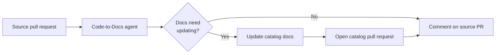
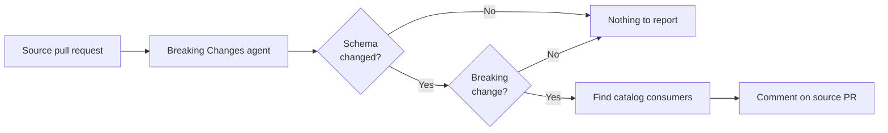
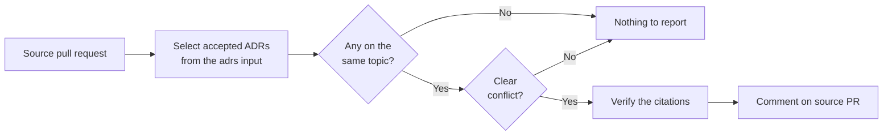
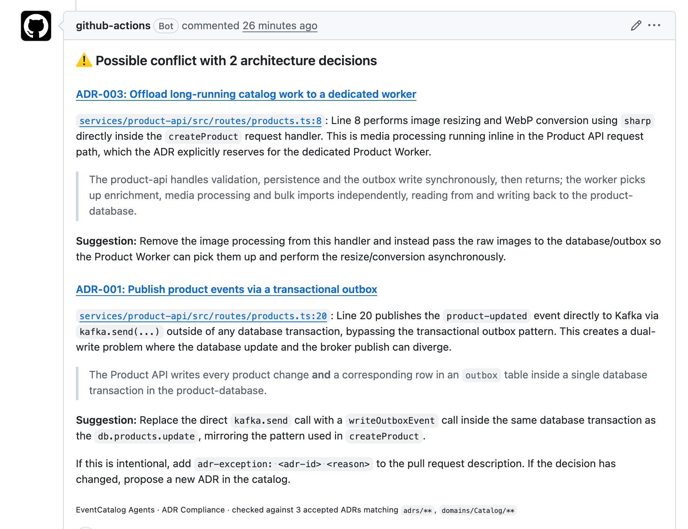
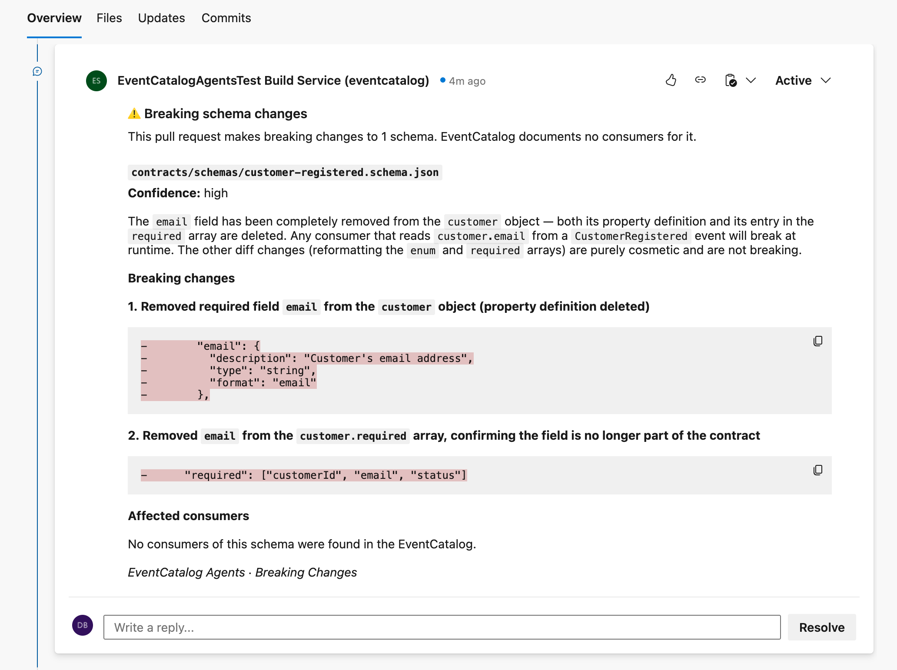
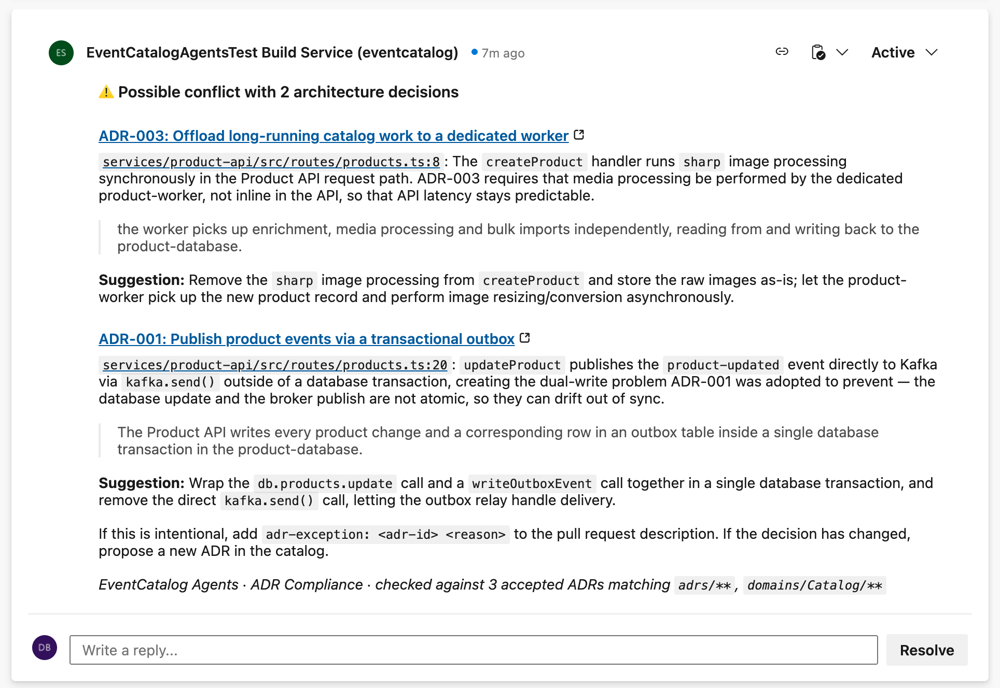

# EventCatalog Agents

AI agents that help you manage and document your architecture with
[EventCatalog](https://www.eventcatalog.dev).

EventCatalog Agents understand EventCatalog conventions — services, events, commands, queries,
domains, channels, containers, specifications, and more — and use that understanding to keep your
architecture documented and safe to change. They are powered by [Flue](https://flueframework.com) and
guided by bundled Agent Skills.

Today the agents run in your **CI/CD pipeline**, as a **GitHub Action** or in **Azure Pipelines**: each
time you open a pull request, the agents you've enabled review the change and report back. CI is the
first place we run them; it is a delivery surface, not the limit of what the agents are.

## Available agents

| Agent                                     | What it does                                                                                          |
| ----------------------------------------- | ----------------------------------------------------------------------------------------------------- |
| [**Code-to-Docs**](#code-to-docs)         | Keeps your EventCatalog documentation in sync with your code by proposing catalog updates on each PR. |
| [**Breaking Changes**](#breaking-changes) | Detects breaking schema changes in a PR and shows which catalog consumers could be affected.          |
| [**ADR Compliance**](#adr-compliance)     | Checks that the code in a PR follows the architecture decisions (ADRs) documented in your catalog.    |

Each step runs **one** agent, selected with the `agent` setting (default: `code-to-docs`). To run more
than one, add another step with a different `agent`. Get started with
[GitHub Actions](#github-actions) or [Azure Pipelines](#azure-pipelines).

## Code-to-Docs

The **Code-to-Docs** agent keeps your EventCatalog documentation in sync with your code. When you open
a pull request, it reviews the diff, works out which documentation should change, updates it in your
catalog repository, and opens (or updates) a documentation pull request — then comments back on your
source PR with a summary and a link.



### How it works

When a pull request is opened, the Code-to-Docs agent:

1. **Checks out your catalog** repository into `eventcatalog/`.
2. **Collects the changed source files** from the pull request (ignoring noise like `node_modules`,
   build output, etc.).
3. **Plans the impact** — a read-only pass where the agent decides whether the diff requires any
   documentation changes, and if so, exactly which catalog resources should change. If nothing is
   needed, the run stops here and says so.
4. **Applies the plan** — the agent updates the catalog documentation, using the bundled
   EventCatalog skill for correct frontmatter and folder structure. It checks its changes with the
   EventCatalog linter (the version your catalog pins) and with your catalog's
   [fitness functions](#fitness-functions), and fixes problems its changes caused. It is only allowed
   to touch the resources approved in the plan; edits outside that plan are rejected.
5. **Handles version bumps** — when the agent bumps a message's version (for a breaking change), the
   services and agents that pin the old version are approved for editing automatically, and the
   previous version is archived to `versioned/<version>/` so it stays documented.
6. **Opens a catalog PR** — commits the changes to an `eventcatalog-actions/...` branch in your
   catalog repository and opens or updates a pull request against `catalog-ref`. Its description
   links the source PR, lists the resources that changed, and flags anything worth checking.
7. **Comments on the source PR** with the catalog PR link and a table of the catalog resources it
   added, updated, or removed. If it couldn't update the docs, the comment says why and what to do.

Deterministic work (diff parsing, path resolution, git writes, token preflight, change detection)
stays in TypeScript. The agent is responsible only for reasoning about documentation.

## Breaking Changes

The **Breaking Changes** agent watches your message schemas. When a pull request changes a schema, it
decides whether the change is breaking for existing consumers and, if so, traces it through your
EventCatalog to the resources that could be affected — then comments back on your source PR with the
breaking lines highlighted and the affected consumers listed. It is read-only: it never edits your
catalog.



### How it works

When a pull request is opened, the Breaking Changes agent:

1. **Checks out your catalog** repository into `eventcatalog/`.
2. **Finds changed schema files** in the pull request (`.json`, `.yml`, Avro, Protobuf, GraphQL, and
   similar). If the PR touches no schemas, the run stops here.
3. **Scores each schema change** — a read-only pass that decides whether the change is breaking
   (a removed/renamed field, a type change, a new required field, a narrowed enum, and so on).
   Additive changes are not breaking and are skipped.
4. **Finds affected consumers** — for each breaking change, the agent traces the schema to the
   resource it belongs to and finds the services and flows that consume it (the producer that sends
   the message is not counted).
5. **Comments on the source PR** with each breaking change, its highlighted lines, and the consumers
   that could be affected. If `catalog-url` is configured, affected consumers and owner teams link to
   your hosted catalog. If no consumers are found, it logs that and skips the comment.

## ADR Compliance

The **ADR Compliance** agent checks that the code a pull request changes follows the Architecture
Decision Records in your EventCatalog. You point it at the ADRs that apply to the repository, and it
comments on the source PR only when the code clearly conflicts with one. It is read-only and advisory:
it never edits your catalog or blocks a merge.





### Choosing which ADRs to check

The `adrs` setting is required. It takes comma-separated globs relative to your catalog root, so a
repository can check against org-wide decisions and those of its own domain. Add this step to the
workflow from [GitHub Actions](#github-actions) (in Azure Pipelines, pass the same `adrs` value as a
[template parameter](#azure-pipelines-parameters)):

```yaml
- uses: event-catalog/agents@v2
  env:
    ANTHROPIC_API_KEY: ${{ secrets.ANTHROPIC_API_KEY }}
  with:
    agent: adr-compliance
    adrs: adrs/**, domains/Orders/**
    catalog-repo: your-org/your-catalog
    catalog-url: https://catalog.example.com
    catalog-token: ${{ secrets.EVENTCATALOG_TOKEN }}
```

| To check against                                 | Use                                    |
| ------------------------------------------------ | -------------------------------------- |
| ADRs in the top-level `adrs/` folder             | `adrs/**`                              |
| A domain, and everything nested in it            | `domains/Orders/**`                    |
| One service                                      | `domains/Orders/services/OrdersAPI/**` |
| ADRs that share a naming convention              | `adrs/adr-orders-*/**`                 |
| One ADR                                          | `adrs/adr-012-use-outbox`              |
| Every ADR in the catalog, as a deliberate choice | `'**/adrs/**'` (YAML needs the quotes) |

Only `accepted` ADRs are checked, at their latest version. If an accepted ADR amends one you selected,
it is included too, because the decision can't be judged correctly without it. If `adrs` is missing or
matches nothing, the run fails with an error, so a typo can't look like a clean pass.

ADRs can live under any `adrs` folder in your catalog, so point the globs at wherever yours are. The
`catalog-token` only needs read access, because this agent never writes to the catalog.

### How it works

1. **Selects the ADRs** matching `adrs` from your catalog.
2. **Triages** their summaries against the diff, so only ADRs on the same topic are reviewed in full.
3. **Reviews** the changed lines against those ADRs, reporting only clear conflicts.
4. **Verifies each citation**: the line must be one this pull request changed, and the quoted sentence
   must really be in the ADR. A conflict that fails this check is dropped.
5. **Comments on the source PR** with each conflict, the sentence from the ADR, and a suggestion. The
   comment updates on every push, and says so once the conflicts are gone. A pull request with no
   conflicts gets no comment.

### Recording an exception

If a conflict is intentional, add a line with the ADR's id and your reason to the pull request
description. The conflict is then listed as an exception in the comment, so reviewers can still see it:

```text
adr-exception: adr-003-offload-async-work-to-worker image resize takes under 5ms
```

The agent reads the description when it runs, so push a commit or re-run the workflow after adding the
line. On GitHub, to re-run automatically when the description changes, add `edited` to the workflow's
`pull_request` types. Azure Pipelines doesn't run on description changes: re-queue the pull request's
build validation instead.

If the decision itself has changed, propose a new ADR in your catalog instead.

## Get started

The agents run where your pull requests are:

| Your source code is in | Run the agents with                              |
| ---------------------- | ------------------------------------------------ |
| GitHub                 | the [GitHub Action](#github-actions)             |
| Azure Repos            | the [Azure Pipelines template](#azure-pipelines) |

Your catalog can be in either: for example, source code in Azure Repos with the catalog on GitHub. See
[Using a catalog on GitHub](#using-a-catalog-on-github).

## GitHub Actions

Run an agent on your repository in three steps.

**1. Add your model provider key** as a secret in your repository (Settings → Secrets and variables →
Actions). Use the one that matches your chosen model — e.g. `ANTHROPIC_API_KEY`, `OPENAI_API_KEY`, or
`OPENROUTER_API_KEY`.

**2. Add a workflow** at `.github/workflows/eventcatalog.yml`:

```yaml
on:
  pull_request:

jobs:
  eventcatalog:
    runs-on: ubuntu-latest
    permissions:
      contents: read
      issues: write
      pull-requests: write
    steps:
      - uses: actions/checkout@v6
        with:
          fetch-depth: 0

      - uses: event-catalog/agents@v2
        env:
          ANTHROPIC_API_KEY: ${{ secrets.ANTHROPIC_API_KEY }}
        with:
          agent: code-to-docs # or: breaking-changes, adr-compliance
          catalog-repo: your-org/your-catalog
          catalog-url: https://catalog.example.com
          catalog-token: ${{ secrets.EVENTCATALOG_TOKEN }}
```

**3. Open a pull request.** The selected agent runs and reports back on your source PR.

> `fetch-depth: 0` is required so the agent can diff the pull request against its base. See
> [Inputs](#inputs) for all configuration options, and [When to run](#when-to-run) to run Code-to-Docs only
> once a pull request merges (recommended).

### Choosing an agent

Each Action step runs a single `agent`. To run more than one, add another step in the same job (or a
second workflow file):

```yaml
- uses: event-catalog/agents@v2
  env:
    ANTHROPIC_API_KEY: ${{ secrets.ANTHROPIC_API_KEY }}
  with:
    agent: code-to-docs
    catalog-repo: your-org/your-catalog
    catalog-url: https://catalog.example.com
    catalog-token: ${{ secrets.EVENTCATALOG_TOKEN }}

- uses: event-catalog/agents@v2
  env:
    ANTHROPIC_API_KEY: ${{ secrets.ANTHROPIC_API_KEY }}
  with:
    agent: breaking-changes
    catalog-repo: your-org/your-catalog
    catalog-url: https://catalog.example.com
    catalog-token: ${{ secrets.EVENTCATALOG_TOKEN }}
```

### When to run

Agents can run while a pull request is open, or once it is merged. We recommend running **Code-to-Docs
when a pull request merges**, and **Breaking Changes and ADR Compliance while it is open**:

| Agent            | Recommended trigger                     | Why                                                                                                                          |
| ---------------- | --------------------------------------- | ---------------------------------------------------------------------------------------------------------------------------- |
| Code-to-Docs     | When merged (`types: [closed]`)         | Documents what actually shipped, runs once per pull request, and never documents abandoned work.                             |
| Breaking Changes | While open (`opened`, `synchronize`, …) | Its job is to warn before a breaking change merges. Run after merging, the warning comes too late to act on before it ships. |
| ADR Compliance   | While open (`opened`, `synchronize`, …) | Its job is to raise a conflict while the code can still change.                                                              |

Running Code-to-Docs on open pull requests also works: the catalog pull request is ready for review
alongside the code, and is updated on every push. It runs more often, though, and most updates to a
pull request don't change the documentation.

```yaml
# .github/workflows/eventcatalog.yml
on:
  pull_request:
    types: [opened, synchronize, reopened, closed]

jobs:
  code-to-docs:
    # Only once the pull request is merged.
    if: github.event.action == 'closed' && github.event.pull_request.merged == true
    runs-on: ubuntu-latest
    permissions:
      contents: read
      issues: write
      pull-requests: write
    steps:
      - uses: actions/checkout@v6
        with:
          ref: ${{ github.event.pull_request.head.sha }}
          fetch-depth: 0
      - uses: event-catalog/agents@v2
        env:
          ANTHROPIC_API_KEY: ${{ secrets.ANTHROPIC_API_KEY }}
        with:
          agent: code-to-docs
          catalog-repo: your-org/your-catalog
          catalog-token: ${{ secrets.EVENTCATALOG_TOKEN }}

  breaking-changes:
    # While the pull request is open.
    if: github.event.action != 'closed'
    runs-on: ubuntu-latest
    permissions:
      contents: read
      issues: write
      pull-requests: write
    steps:
      - uses: actions/checkout@v6
        with:
          ref: ${{ github.event.pull_request.head.sha }}
          fetch-depth: 0
      - uses: event-catalog/agents@v2
        env:
          ANTHROPIC_API_KEY: ${{ secrets.ANTHROPIC_API_KEY }}
        with:
          agent: breaking-changes
          catalog-repo: your-org/your-catalog
          catalog-token: ${{ secrets.EVENTCATALOG_TOKEN }}
```

Use `pull_request` with `types: [closed]` rather than `push` to your main branch: the agents need the
pull request to diff against and to comment on. If a pull request is closed without merging, the
agents skip it without commenting.

### Inputs

| Input                    | Required           | Default                       | Description                                                                                                                                                  |
| ------------------------ | ------------------ | ----------------------------- | ------------------------------------------------------------------------------------------------------------------------------------------------------------ |
| `agent`                  | No                 | `code-to-docs`                | Which agent to run: `code-to-docs`, `breaking-changes`, or `adr-compliance`.                                                                                 |
| `adrs`                   | For ADR Compliance |                               | Comma-separated globs, relative to the catalog root, selecting the ADRs to check against. See [Choosing which ADRs to check](#choosing-which-adrs-to-check). |
| `catalog-repo`           | Yes                |                               | EventCatalog repository to read/document, in `owner/repo` format.                                                                                            |
| `catalog-ref`            | No                 | `main`                        | Branch checked out from the catalog repository and targeted by documentation PRs.                                                                            |
| `catalog-token`          | No                 | `github.token`                | Token used to check out the catalog repository and open documentation pull requests. Not needed with a [GitHub App](#using-a-github-app).                    |
| `github-app-client-id`   | No                 |                               | Client ID of a GitHub App installed on the catalog repository. With `github-app-private-key`, the agent uses the App instead of `catalog-token`.             |
| `github-app-private-key` | No                 |                               | Private key of that GitHub App. Pass it from a secret.                                                                                                       |
| `catalog-url`            | No                 |                               | URL of your hosted EventCatalog. When set, Breaking Changes and ADR Compliance comments link to catalog pages.                                               |
| `model`                  | No                 | `anthropic/claude-sonnet-4-6` | Model specifier for the agent. See [available models](https://pi.dev/models).                                                                                |
| `ignore-paths`           | No                 | see [action.yml](action.yml)  | Comma-separated paths or glob patterns to ignore in PR diffs.                                                                                                |
| `schema-extensions`      | No                 | see [action.yml](action.yml)  | Comma-separated file extensions the Breaking Changes agent treats as message schemas. Add others (e.g. `.js`) to match where your contracts live.            |

The agents run on [Flue](https://flueframework.com), which supports models from many providers — see
the full list of model specifiers at [pi.dev/models](https://pi.dev/models).

> **Breaking Changes only looks at schema files.** By default that means `.json`, `.yml`, `.yaml`,
> `.avro`, `.avsc`, `.proto`, `.graphql`, and `.gql`. If your message contracts live in source files
> (for example a `messages.js`), add that extension via `schema-extensions` so the agent inspects it.

### Using a separate catalog repository

The catalog is always checked out to `eventcatalog/` under `$GITHUB_WORKSPACE`. When your catalog
lives in a **different** repository from your source code, provide a `catalog-token` with permission
to read it — and, for Code-to-Docs, to push branches and open pull requests in it (the default
`github.token` only has access to the current repository).

### Using a GitHub App

Instead of a personal access token, you can give the agent a GitHub App. Catalog pull requests are
then opened by the App's bot account rather than a person, and the agent gets a token that is scoped
to the catalog repository and expires after an hour.

1. [Create a GitHub App](https://docs.github.com/en/apps/creating-github-apps/registering-a-github-app/registering-a-github-app)
   in your organization with these repository permissions: **Contents: Read and write** and
   **Pull requests: Read and write**. It doesn't need a webhook.
2. Generate a private key for the App, and install the App on your catalog repository.
3. Add the App's Client ID and private key to your source repository's secrets, and pass them to the
   action instead of `catalog-token`:

```yaml
- uses: event-catalog/agents@v2
  env:
    ANTHROPIC_API_KEY: ${{ secrets.ANTHROPIC_API_KEY }}
  with:
    agent: code-to-docs
    catalog-repo: your-org/your-catalog
    github-app-client-id: ${{ vars.EVENTCATALOG_APP_CLIENT_ID }}
    github-app-private-key: ${{ secrets.EVENTCATALOG_APP_PRIVATE_KEY }}
```

## Azure Pipelines

For source code in Azure Repos, the agents run in Azure Pipelines from a steps template,
[`azure-pipelines/eventcatalog-agents.yml`](azure-pipelines/eventcatalog-agents.yml). The agents do the
same work as on GitHub: they comment on the pull request in a thread, and Code-to-Docs opens its
documentation pull requests in your catalog repository. The catalog can be in Azure Repos (the default)
or [on GitHub](#using-a-catalog-on-github).



Pull request runs come from a **build validation** branch policy, the usual way to run checks on Azure
Repos pull requests (Azure Repos ignores the YAML `pr:` trigger). Code-to-Docs runs from the pipeline's
CI trigger once a pull request merges, and finds the pull request from the merge commit.

### 1. Add your model provider key

In **Pipelines → Library**, create a variable group (for example `eventcatalog`) with your model
provider key as a secret variable: `ANTHROPIC_API_KEY`, `OPENAI_API_KEY`, or `OPENROUTER_API_KEY`.
Secret variables only reach the agent when you pass them in the template's `env` parameter, as the
pipeline below does.

### 2. Give the build service access

The agents use the pipeline's own token (`System.AccessToken`), so no personal token is needed. Its
identity is the project's build service, **`<Project> Build Service (<Organization>)`** (or **`Project
Collection Build Service (<Organization>)`** if your pipelines aren't limited to the current project). In
**Project settings → Repositories**, allow it:

| Repository        | Permissions                                                        | For                                    |
| ----------------- | ------------------------------------------------------------------ | -------------------------------------- |
| Your source repo  | **Contribute to pull requests**                                    | Comments on pull requests (all agents) |
| Your catalog repo | **Read**                                                           | Breaking Changes and ADR Compliance    |
| Your catalog repo | **Contribute**, **Create branch**, **Contribute to pull requests** | Code-to-Docs                           |

If the catalog is in a different project, also allow the build service to
[access that project](https://learn.microsoft.com/azure/devops/pipelines/process/access-tokens#configure-permissions-for-a-project-to-access-another-project-in-the-same-project-collection),
or use a [personal access token](#using-a-personal-access-token) instead.

### 3. Add the pipeline

The template is in this repository, so reference it as a repository resource. Azure Pipelines needs a
[GitHub service connection](https://learn.microsoft.com/azure/devops/pipelines/library/service-endpoints#github-service-connection)
to read templates from GitHub (the repository is public, so any connection works). Without one, see
[Using the template without a GitHub connection](#using-the-template-without-a-github-connection).

Add `eventcatalog-agents.yml` to your source repository, and create a pipeline from it (**Pipelines → New
pipeline → Azure Repos Git → Existing Azure Pipelines YAML file**):

```yaml
# eventcatalog-agents.yml
trigger:
  branches:
    include: [main] # Code-to-Docs runs once a pull request merges into main

resources:
  repositories:
    - repository: eventcatalog-agents
      type: github
      endpoint: github # the name of your GitHub service connection
      name: event-catalog/agents
      ref: refs/tags/v2
    - repository: catalog
      type: git
      name: Architecture/eventcatalog # your catalog: Project/Repo

pool:
  vmImage: ubuntu-latest

variables:
  - group: eventcatalog # holds ANTHROPIC_API_KEY

jobs:
  # While the pull request is open (build validation).
  - job: review
    condition: eq(variables['Build.Reason'], 'PullRequest')
    uses:
      repositories: [catalog]
    steps:
      - checkout: self
        fetchDepth: 0

      - template: azure-pipelines/eventcatalog-agents.yml@eventcatalog-agents
        parameters:
          agent: breaking-changes
          catalogRepo: Architecture/eventcatalog
          catalogUrl: https://catalog.example.com
          env:
            ANTHROPIC_API_KEY: $(ANTHROPIC_API_KEY)

      - template: azure-pipelines/eventcatalog-agents.yml@eventcatalog-agents
        parameters:
          agent: adr-compliance
          adrs: adrs/**, domains/Orders/**
          catalogRepo: Architecture/eventcatalog
          catalogUrl: https://catalog.example.com
          env:
            ANTHROPIC_API_KEY: $(ANTHROPIC_API_KEY)

  # Once the pull request has merged (CI build of main).
  - job: document
    condition: ne(variables['Build.Reason'], 'PullRequest')
    uses:
      repositories: [catalog]
    steps:
      - checkout: self
        fetchDepth: 0

      - template: azure-pipelines/eventcatalog-agents.yml@eventcatalog-agents
        parameters:
          agent: code-to-docs
          catalogRepo: Architecture/eventcatalog
          env:
            ANTHROPIC_API_KEY: $(ANTHROPIC_API_KEY)
```

- `fetchDepth: 0` is required so the agent can diff the pull request against its target branch. New
  pipelines fetch only the latest commit by default.
- The `catalog` repository resource and `uses` give the job's token access to the catalog, which
  **Protect access to repositories in YAML pipelines** requires (it is on by default). Approve the
  pipeline's access to it on its first run.
- Each `template` step runs one agent. Use only the agents you want, and the same
  [recommended triggers](#when-to-run) as on GitHub apply.

### 4. Add build validation

In **Project settings → Repositories → your source repo → Policies**, open the `main` branch, and under
**Build validation** add the pipeline. Set **Trigger** to _Automatic_, and **Policy requirement** to
_Optional_: the agents are advisory, and a failure such as a model provider outage shouldn't block a
merge.

### 5. Open a pull request

Breaking Changes and ADR Compliance comment on the pull request; once it merges, Code-to-Docs opens a
documentation pull request in your catalog and comments with the link.

### On Azure DevOps

The agents behave as they do on GitHub, with these differences:

- **Comments are threads.** Breaking Changes and ADR Compliance open an **active** thread, so reviewers
  see it; it counts towards the _Check for comment resolution_ policy if you use one. When an ADR
  conflict is fixed, its thread is marked **resolved**. Code-to-Docs posts its summary as a **closed**
  thread, because there is nothing to resolve on the pull request. Each agent keeps one thread up to
  date rather than adding new ones.

  

- **Impact diagrams** in Breaking Changes comments show as Mermaid source: Azure DevOps renders Mermaid
  only in wikis.
- **Catalog pull request descriptions** are shortened to fit Azure DevOps' 4,000-character limit.
- **Runs after a merge** find the pull request that merged from the commit (merge or squash). A commit
  pushed straight to `main` has no pull request, so the agents skip it. Leave CI batching off
  (`batch: true`): a batched build reviews only the last pull request it contains.
- **Which builds run.** Pull request builds review the open pull request; CI builds and runs queued by
  hand review the pull request that merged. Scheduled and other builds have no pull request, and are
  skipped.

### Azure Pipelines parameters

| Parameter          | Required           | Default                       | Description                                                                                                                                         |
| ------------------ | ------------------ | ----------------------------- | --------------------------------------------------------------------------------------------------------------------------------------------------- |
| `agent`            | No                 | `code-to-docs`                | Which agent to run: `code-to-docs`, `breaking-changes`, or `adr-compliance`.                                                                        |
| `adrs`             | For ADR Compliance |                               | Comma-separated globs, relative to the catalog root, selecting the ADRs to check against.                                                           |
| `catalogRepo`      | Yes                |                               | The catalog repository: `Project/Repo` (or `Repo` in the same project), or its URL. `owner/repo` for GitHub.                                        |
| `catalogRef`       | No                 | `main`                        | Branch checked out from the catalog repository and targeted by documentation pull requests.                                                         |
| `catalogProvider`  | No                 | `azure-devops`                | Where the catalog is hosted: `azure-devops` or `github`.                                                                                            |
| `catalogToken`     | No                 | `$(System.AccessToken)`       | Token used to check out the catalog and open documentation pull requests.                                                                           |
| `catalogUrl`       | No                 |                               | URL of your hosted EventCatalog. When set, Breaking Changes and ADR Compliance comments link to catalog pages.                                      |
| `model`            | No                 | `anthropic/claude-sonnet-4-6` | Model specifier for the agent. See [available models](https://pi.dev/models).                                                                       |
| `ignorePaths`      | No                 | see the template              | Comma-separated paths or glob patterns to ignore in pull request diffs.                                                                             |
| `schemaExtensions` | No                 | see the template              | Comma-separated file extensions the Breaking Changes agent treats as message schemas.                                                               |
| `workspace`        | No                 | `$(Build.SourcesDirectory)`   | The source checkout to diff. When a job checks out more than one repository, `self` moves to `$(Build.SourcesDirectory)/<repo>`: set this to match. |
| `agentsVersion`    | No                 | `v2`                          | The EventCatalog Agents release to run. Keep it the same as the `ref` of the `eventcatalog-agents` resource.                                        |
| `env`              | No                 | `{}`                          | Environment for the agent, such as your model provider key: `{ ANTHROPIC_API_KEY: $(ANTHROPIC_API_KEY) }`.                                          |

To pin a release, set both the resource `ref` (for example `refs/tags/v2.3.0`) and `agentsVersion:
v2.3.0`.

### Using a personal access token

To open catalog pull requests as a person or service account rather than the build service, create a
personal access token with the **Code (Read & write)** scope, store it as a secret variable, and pass it
as `catalogToken: $(EVENTCATALOG_TOKEN)`. Comments on the source pull request still come from the
build service.

### Using a catalog on GitHub

With source code in Azure Repos and the catalog on GitHub, set `catalogProvider: github`, `catalogRepo`
to `owner/repo`, and `catalogToken` to a GitHub token from a secret variable. A
[fine-grained token](https://docs.github.com/authentication/keeping-your-account-and-data-secure/managing-your-personal-access-tokens)
scoped to the catalog repository needs **Contents** (read, and write for Code-to-Docs) and, for
Code-to-Docs, **Pull requests: Read and write**. The `catalog` repository resource and `uses` aren't
needed.

```yaml
- template: azure-pipelines/eventcatalog-agents.yml@eventcatalog-agents
  parameters:
    agent: code-to-docs
    catalogProvider: github
    catalogRepo: your-org/your-catalog
    catalogToken: $(GITHUB_CATALOG_TOKEN)
    env:
      ANTHROPIC_API_KEY: $(ANTHROPIC_API_KEY)
```

### Using the template without a GitHub connection

Copy [`azure-pipelines/eventcatalog-agents.yml`](azure-pipelines/eventcatalog-agents.yml) into your
repository (or a shared templates repository in Azure Repos), and reference it by path, for example
`template: templates/eventcatalog-agents.yml`. Set `agentsVersion` to the release you copied it from.
The template still downloads the agents from GitHub when it runs, so the build agent needs internet
access, as it does for the model provider and npm.

### Azure DevOps Server

The agents use Azure DevOps REST API version 6.0, which Azure DevOps Server 2020 and later support, and
read the organization's URL from the pipeline, so they should work on Azure DevOps Server too. A full
`catalogRepo` URL on Server must include the project
(`https://server/tfs/Collection/Project/_git/Repo`), even when the repository is named after it. We test
against Azure DevOps Services; if you run them on Server, please
[let us know](https://github.com/event-catalog/agents/issues) how it goes.

## Configuration

### Provider API keys

The model provider's API key is passed to the agent as an environment variable: in the step's `env` on
GitHub, and in the template's `env` parameter in Azure Pipelines. Set the one that matches your `model`:

| Provider   | Env var              |
| ---------- | -------------------- |
| Anthropic  | `ANTHROPIC_API_KEY`  |
| OpenAI     | `OPENAI_API_KEY`     |
| OpenRouter | `OPENROUTER_API_KEY` |

### Fitness functions

[Fitness functions](https://www.eventcatalog.dev/docs) are architecture rules you write for your
catalog, in `fitness/*.fitness.ts` files (for example "every event has a single producer"). When your
catalog has them, the Code-to-Docs agent runs them after making its changes and fixes any problems its
changes introduced. Problems that were already in your catalog are left alone.

Fitness functions are code from your catalog repository, so the agent runs them in a separate process
that does not receive your model provider key or GitHub and Azure DevOps tokens. The agent can never create or edit
fitness functions: a run that tries is rejected as off-plan.

We recommend also running the linter, your fitness functions and a build in your catalog repository's
own CI, so every pull request — the agent's included — is checked before it is merged:

```yaml
# .github/workflows/catalog-checks.yml in your catalog repository
on: pull_request
jobs:
  checks:
    runs-on: ubuntu-latest
    steps:
      - uses: actions/checkout@v6
      - uses: actions/setup-node@v6
        with:
          node-version: 24
      - run: npm ci
      - run: npx eventcatalog-linter
      - run: npx eventcatalog fitness check
      - run: npx eventcatalog build
```

In Azure Repos, add the same checks as a pipeline in your catalog repository, and make it a
[build validation](#4-add-build-validation) on the catalog's main branch:

```yaml
# azure-pipelines.yml in your catalog repository
trigger: none
pool:
  vmImage: ubuntu-latest
steps:
  - task: UseNode@1
    inputs:
      version: 24.x
  - script: npm ci
  - script: npx eventcatalog-linter
  - script: npx eventcatalog fitness check
  - script: npx eventcatalog build
```

### Usage analytics

The agents send one anonymous event per run so we can see how they are used. It contains the run's
outcome (and, for a failed run, the kind of error, such as an invalid model provider key), the model,
the run's duration, whether it ran on an open or a merged pull request, the repository name, the CI
system (GitHub Actions or Azure Pipelines), and for Code-to-Docs, how many of the agent's catalog pull
requests are open, merged, or closed without merging. It never contains anything from your
repositories: no code, file names, paths, diffs, or pull request content. Set `POSTHOG_KEY: ""` in the
step's `env` (or the Azure Pipelines template's `env` parameter) to turn it off.

## Development

This project uses [pnpm](https://pnpm.io) and requires Node.js `>=22.19.0` (Flue's minimum; CI uses
Node 24).

```sh
pnpm install

# Build + typecheck + run the eval suite
pnpm test

# Run only the evals (see evals/README.md)
pnpm run evals

# Run an agent locally against a checked-out workspace (code-to-docs, breaking-changes, or adr-compliance)
pnpm exec tsx src/run.ts code-to-docs --payload '{"workspace":"/tmp/example"}'

# Check out a catalog into <workspace>/eventcatalog, as the Azure Pipelines template does
pnpm exec tsx src/checkout-catalog.ts --payload '{"workspace":"/tmp/example","catalogRepo":"acme/catalog","catalogToken":"..."}'
```

See [`AGENTS.md`](AGENTS.md) for the project layout and contributor guidelines, and
[`evals/README.md`](evals/README.md) for how the agents are evaluated.

## License

This project is source-available under the [Business Source License 1.1](LICENSE).

You are free to read the code, modify it, and contribute, and to use it for non-production
purposes such as evaluation, development, and testing. **Production use requires a commercial
EventCatalog license** — contact hello@eventcatalog.dev. Each release converts to the Apache
License 2.0 four years after it is published.
